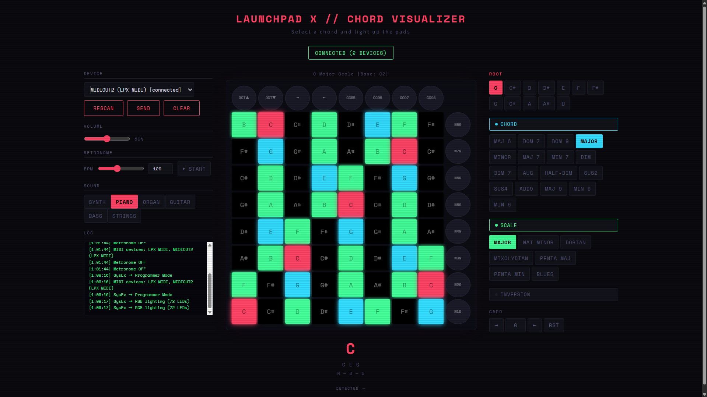

# [Launchpad X Chord Visualizer](https://launchpad-chord-visualizer.pages.dev/)



## 機能

- **コード・スケール表示** — ルート音・コードトーン・スケール音をそれぞれ異なる色でパッドに表示。押すべき音が一目でわかる
- **17種のコードタイプ** — Major / Minor / Dom7 / Maj7 / Min7 / Dim / Dim7 / Aug / Half-Dim / Sus2 / Sus4 / Add9 / Dom9 / Maj9 / Min9 / Maj6 / Min6
- **7種のスケール** — Major / Natural Minor / Dorian / Mixolydian / Pentatonic Major / Pentatonic Minor / Blues
- **転回形** — コードの最低音を変えた転回形を選択可能。スラッシュコード表記（例: `C/E`）で表示
- **コード自動検出** — 複数のパッドを同時に押さえると、構成音からコード名を自動で判定して表示
- **カポ / オクターブシフト** — 全パッドのキーをまとめて移調。カポはギターのカポタストと同じ概念で視覚パターンを変えずに移調、オクターブは音域を1オクターブ上下
- **22種の音色** — GM Soundfont のサンプル音源（Piano / E.Piano / Organ / Guitar / Bass / Strings / Choir / Vibes / Flute / Sax ほか）。初回のみ CDN からサンプルを読み込み、2回目以降はブラウザキャッシュから即再生。オフライン時は Web Audio のシンセ音にフォールバック
- **メトロノーム** — 40〜240 BPM、アクセント拍 LED 連動
- **曲に合わせて演奏（Song）** — [Songle](https://songle.jp/) に登録された曲（YouTube / ニコニコ動画 / SoundCloud / ピアプロ）を画面内で再生し、コード進行に合わせてパッドと Launchpad を自動で点灯。曲名検索・カポ・次のコードの予告・A-B ループ付き

## 動作要件

- **Chrome ブラウザ**（Web MIDI API / Web Audio API 対応）
- Launchpad X（任意 — なくても画面上での操作・音出しは可能）

---

## 使い方

### 基本操作

1. 右パネルで **Root**（ルート音）と **Chord**（コードタイプ）を選択
2. グリッドにコード・スケール音が色分けされて表示される
3. パッドをクリック（または Launchpad X のパッドを押す）と音が鳴る

### 色分けの意味

| 色 | 意味 |
|----|------|
| 赤 | ルート音 |
| 水色 | コードトーン（ルート以外） |
| 緑 | スケール音（コードトーンを除く） |
| 橙 | 転回ベース音（Inversion ON時）/ 分数コードのベース音（Song FOLLOW 時） |
| 薄い赤・水色（点滅） | 次のコードのルート・構成音の予告（Song FOLLOW 時、切替の1拍前から） |
| 黒 | 非該当 |

### カポとオクターブ

- **Capo**（右パネル下部の ◄ ► ボタン、または Launchpad 上段 3・4番目）
  視覚パターンを変えずにキーを半音単位で移調する。ギターのカポタストと同じ動作で、パッドの色パターンはそのままに全体のピッチが変わる。

- **Octave**（Launchpad 上段 1・2番目）
  グリッド全体を1オクターブ上下にシフトする。

### 転回形（Inversion）

右パネルの **Inversion** トグルをONにすると転回形の選択肢が表示される。
1st Inversion は第3音、2nd Inversion は第5音を最低音にした配置で、コード名は `C/E` のようにスラッシュ表記になる。

### コード自動検出

複数のパッドを同時に押さえたままにすると、現在鳴っている音の組み合わせからコード名を自動判定してコード名表示エリアに反映する。

### メトロノーム

左パネルの **Metronome** セクションで BPM を設定し **START** を押す。
Launchpad X 接続時はロゴ LED が拍に合わせてフラッシュする（アクセント拍は白、通常拍は青白）。
MIDI 未接続時は起動しない。

### 曲に合わせて演奏（Song）

画面上部の **Song** バーに曲名・アーティスト名を入れて **LOAD / SEARCH**（Enter でも可）→ 候補から選ぶ。URL（YouTube / ニコニコ動画 / SoundCloud / ピアプロ）を直接入れてもよい。

- コード進行は [Songle](https://songle.jp/) から取得する。Songle に登録されていない曲は読み込めない
- 再生は Songle の埋め込みプレイヤー（SoundCloud は SoundCloud のプレイヤー）
- YouTube の曲は **ANALYZE ↗** の解析結果に切り替えることもできる（Songle のコードが合わないとき用）
- **FOLLOW** ON の間は、再生位置のコードで Root / Chord が自動で切り替わり、スケールは曲のキー基準になる。Root / Chord / Inversion を手で選ぶと FOLLOW は一時停止
- **CAPO** はメイン画面の Capo と共通。AUTO は構成音が C メジャースケールに最も収まる位置を選ぶ。Launchpad はカポ後の押さえ方で光り、音は原曲キーで鳴る（例: E♭ の曲を Capo 3 → C の形で光り E♭ で鳴る）
- 次のコードに変わる1拍前から、その構成音が薄く点滅する
- **PRACTICE** ON で練習モード: 光る電子ピアノのように、弾くコードだけが光り、それ以外（スケール・予告）は消灯する。光るのはルートを最低音にした基本形のコード1つ分で、ルートは下から3段目・左から3列目のパッド（デフォルトなら C3）から1オクターブ以内。同じ音が出るパッドは全部光るので、押さえやすい位置を選んで弾ける。コードが変わる半拍前に次のコードへ切り替わる
- **A-B** で区間ループ（1回目 A 点 → 2回目 B 点 → 3回目で解除）。タイムラインのクリックでシーク
- 読み込んだ曲はページの URL（YouTube は `?v=<動画ID>`、それ以外は `?url=<URL>`）に残るので、ブックマークすれば次回もその曲から始められる

### コード解析ページ（analyze.html）

YouTube の曲のコード進行を、音声から推定するプロトタイプページ。Song バーの **ANALYZE ↗** から開く（単体でも使える）。

- **SCAN**: YouTube を最大 2 倍速で再生しながらタブ音声をキャプチャして解析（共有ダイアログで「このタブ」と「タブの音声を共有」を選ぶ）
- **AUDIO FILE**: 手元の音源ファイルを解析
- **SONGLE**: Songle に登録済みなら、そのコード進行を表示（解析結果と切替。解析結果が無ければ LOAD 時に自動取得）
- Decode / Separation の設定で再スキャンせずに結果を調整できる。解析結果は動画ごとにブラウザ（localStorage）に保存され、メイン画面の Song バーからも使える

### パネル構成

| パネル | 内容 |
|--------|------|
| 上（Song） | 曲の検索 / プレイヤー / NOW・NEXT コード / キー・カポ / 再生操作・FOLLOW・A-B / タイムライン（▾ で折りたたみ） |
| 左 | MIDI デバイス選択 / RESCAN / 音量 / メトロノーム / 楽器切替 / ログ |
| 中央 | 9×9 パッドグリッド（Launchpad X と同じレイアウト） |
| 右 | Root / Chord / Scale / Inversion / Capo コントロール |

---

## Launchpad X のセットアップ

1. USB で接続し、左パネルの **RESCAN** ボタンをクリック
2. デバイスが検出されるとロゴ LED が緑に点灯し、Programmer モードへ自動で切替わる
3. 接続できない場合は Ableton Live などの DAW が MIDI ポートを占有していないか確認する（Windows では MIDI ポートは排他使用）

### Launchpad 上段ボタン

| ボタン位置 | 機能 |
|-----------|------|
| 1番目（左） | Octave Up |
| 2番目 | Octave Down |
| 3番目 | Capo Down（-1半音） |
| 4番目 | Capo Up（+1半音） |
| 5番目 | Song: 再生 / 一時停止（再生中は緑） |
| 6番目 | Song: 1小節戻る |
| 7番目 | Song: FOLLOW ON/OFF（ON で水色） |
| 8番目 | Song: A-B ループ（A 設定で黄、ループ中は紫） |

---

## ローカルで動かす

ES Modules は `file://` では動作しないため、ローカルサーバーが必要。

```bash
# Python
python -m http.server 8080

# Node.js
npx serve .
```

VS Code の Live Preview 拡張機能でも起動できる。ただし Song バーと解析ページは動画の埋め込みやタブ音声のキャプチャを使うため、通常の Chrome で開くこと。

更新後にボタンが反応しないなど挙動が古いままのときは、ブラウザが古い JS をキャッシュしている。`Ctrl+Shift+R` で強制再読み込みする。
